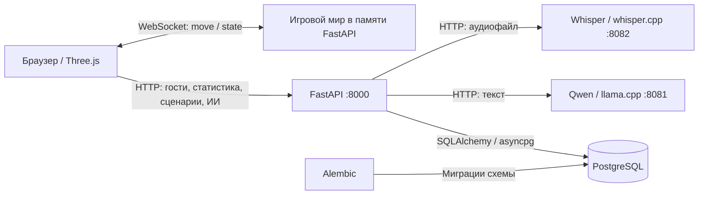
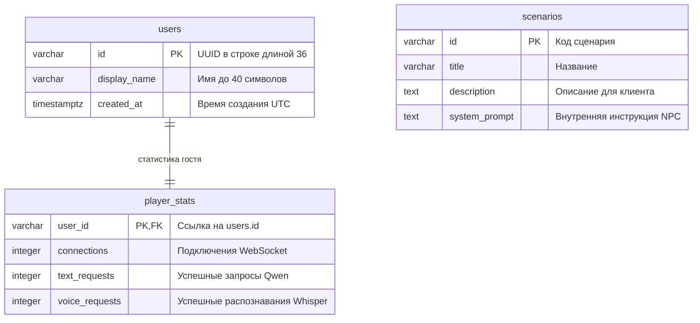

# Архитектура системы и назначение эндпоинтов

Документ описывает текущую реализацию backend. Подготовка окружения и команды
ручного запуска приведены в [Backend.md](Backend.md).

## 1. Общая структура

Браузерный клиент на Three.js отвечает за отображение сцены, ввод игрока и запись
голоса. FastAPI связывает клиента с общей игровой комнатой, PostgreSQL и двумя
локальными ИИ-сервисами. Ответ NPC всегда текстовый.



Клиент обращается к backend; адреса ИИ-сервисов используются внутри сервера.
WebSocket и HTTP обслуживаются одним приложением, но решают разные задачи:
WebSocket передаёт перемещения, HTTP обслуживает данные и запросы к ИИ.
Запрос к ИИ не требует открытого WebSocket, достаточно существующего гостя в БД.

| Компонент | Ответственность | Размещение |
| --- | --- | --- |
| Three.js-клиент | Сцена, управление, отправка координат, запись аудио, показ текста NPC | Браузер; в backend не реализуется |
| FastAPI | Проверка запросов, гостевые профили, статистика, маршрутизация к ИИ | Python-процесс на хосте, порт 8000 при запуске по инструкции |
| `World` и `Peer` | Подключённые игроки, актуальные позиции, рассылка снимков | Память того же Python-процесса |
| PostgreSQL | Постоянные данные пользователей, статистики и сценариев | Сервис `db` в Docker либо отдельная БД |
| Qwen | Генерация текстовых реплик NPC | Уже развёрнутый Docker-сервис `llm`, адрес хоста `localhost:8081` |
| Whisper | Преобразование аудиозаписи в текст | Уже развёрнутый Docker-сервис `stt`, адрес хоста `localhost:8082` |
| Alembic | Создание и изменение схемы БД, начальный сценарий | Отдельная команда, не выполняется при старте FastAPI |

В текущем `docker-compose.yaml` PostgreSQL опубликован на **порту хоста 5435**,
порт внутри контейнера — 5432. Поэтому для этой конфигурации `DATABASE_URL` должен
указывать `localhost:5435`. Значения по умолчанию в `backend/config.py` и
`.env.example` используют порт 5432: при настройке `.env` их нужно согласовать
с фактическим сервером. Имя БД также задаётся согласованно в `POSTGRES_DB` и
`DATABASE_URL`; значение Compose при отсутствии переменной — `request_yourself_db`,
а в `.env.example` — `interview_game`.

## 2. Модули backend

| Файл | Назначение |
| --- | --- |
| `backend/main.py` | Приложение FastAPI, HTTP- и WebSocket-маршруты, жизненный цикл общих ресурсов |
| `backend/config.py` | Чтение настроек окружения и `.env` |
| `backend/database.py` | Асинхронный движок PostgreSQL и сессии SQLAlchemy |
| `backend/models.py` | SQLAlchemy-модели пользователей, статистики и сценариев |
| `backend/schemas.py` | Форматы запросов и ответов, ограничения полей |
| `backend/realtime.py` | Состояние игрового мира и рассылка через WebSocket |
| `backend/ai.py` | Общий HTTP-клиент ИИ-интеграций, ограничения параллельности и обработка ошибок |
| `migrations/env.py` | Подключение Alembic к PostgreSQL и метаданным моделей |
| `migrations/versions/0001_initial.py` | Начальные таблицы и сценарий `interview` |

При старте приложения создаются пустой `World` и общий `httpx.AsyncClient`.
Сессии БД открываются для обработки запросов и закрываются после использования.
Во время ожидания ответа ИИ транзакция чтения БД уже завершена; после ответа
счётчик обновляется отдельной транзакцией. При остановке закрываются HTTP-клиент
и пул подключений БД.

## 3. Постоянные данные и состояние комнаты



Создание гостя записывает профиль и статистику одной транзакцией. При удалении
профиля на уровне БД статистика удаляется каскадно; HTTP-эндпоинта удаления нет.
Сценарии независимы от гостей. API позволяет читать сценарии, но не создавать
и не редактировать их. Системная инструкция хранится в БД и не выдаётся в списке
сценариев. Первая миграция добавляет сценарий собеседования с кодом `interview`.

| Что хранится | Где | Поведение при перезапуске backend |
| --- | --- | --- |
| Профили, счётчики, сценарии | PostgreSQL; в Docker данные находятся в томе `postgres_data` | Сохраняются при сохранности БД/тома |
| Подключения, позиции и повороты | `World.peers` в памяти | Очищаются; клиент подключается заново |
| Номер снимка `revision` | В памяти `World` | Отсчёт начинается заново |
| История диалога и текст реплик | Постоянное хранение не реализовано | Между запросами не восстанавливаются |
| Аудиозапись | Временная загрузка и буфер запроса | Постоянная копия не создаётся |

## 4. Карта эндпоинтов

Базовый адрес для локального запуска: `http://localhost:8000`.
Для WebSocket: `ws://localhost:8000`. Ниже перечислены все прикладные маршруты.
Тела обычных POST-запросов передаются как `application/json`, аудио — как
`multipart/form-data`.

| Метод | Путь | Значение для клиента | Изменения состояния |
| --- | --- | --- | --- |
| POST | `/api/players` | Создать гостя и получить его идентификатор | Новые `users` и `player_stats` |
| GET | `/api/players/{player_id}/stats` | Показать накопленные счётчики гостя | Нет |
| GET | `/api/scenarios` | Получить доступные сценарии | Нет |
| POST | `/api/ai/chat` | Передать реплику игрока и получить ответ NPC | `text_requests + 1` после успешной генерации |
| POST | `/api/ai/transcribe` | Передать запись голоса и получить текст | `voice_requests + 1` после успешного распознавания |
| WS | `/ws/{player_id}` | Войти в общую комнату и обмениваться позициями | `connections + 1`, добавление в мир; дальнейшие движения меняют память |

FastAPI также предоставляет `/docs`, `/redoc` и `/openapi.json` для просмотра
HTTP-контракта. Формат сообщений WebSocket описан ниже: OpenAPI его не раскрывает.

### POST /api/players — создание гостя

Запрос: `{"display_name":"Игрок"}`. Поле имени можно опустить, передав `{}`:
используется `Гость`. После удаления пробелов по краям длина имени — 1–40 символов.

Успех — **201 Created**:

```json
{
  "id": "62bdf532-2755-4820-9bb4-623691940cf8",
  "display_name": "Игрок",
  "created_at": "2026-10-31T12:00:00Z"
}
```

В примерах UUID и время условные. Клиент сохраняет полученный `id` и использует
его далее. Создание профиля само по себе не подключает игрока к комнате.

### GET /api/players/{player_id}/stats — статистика

`player_id` в пути — UUID существующего гостя. Успех — **200 OK**:

```json
{
  "user_id": "62bdf532-2755-4820-9bb4-623691940cf8",
  "connections": 1,
  "text_requests": 3,
  "voice_requests": 2
}
```

`connections` — накопленное число входов, а не число активных соединений.
Повторный вход после выхода увеличивает его снова. Пустой текст от Whisper
при успешном ответе также увеличивает `voice_requests`.

### GET /api/scenarios — доступные сценарии

Параметров нет. Успех — **200 OK**, массив, отсортированный по `id`:

```json
[
  {
    "id": "interview",
    "title": "Собеседование",
    "description": "Практика ответов на вопросы NPC-рекрутера."
  }
]
```

### POST /api/ai/chat — текстовый ответ NPC

```json
{
  "player_id": "62bdf532-2755-4820-9bb4-623691940cf8",
  "scenario_id": "interview",
  "message": "Я отвечал за backend командного проекта."
}
```

`player_id` — строка длиной 36 символов, соответствующая гостю; `scenario_id` —
код существующего сценария длиной 1–50 символов, по умолчанию `interview`.
`message` — 1–1000 символов после удаления пробелов по краям.

Успех — **200 OK**: `{"reply":"Какую задачу вы решили самостоятельно?"}`.
Сервер отправляет в Qwen системную инструкцию сценария и только текущую реплику.
Контекст предыдущих запросов не передаётся. Ответ выдаётся целиком, без стриминга.

### POST /api/ai/transcribe — распознавание записи

| Поле multipart | Тип | Назначение |
| --- | --- | --- |
| `player_id` | UUID, текстовое поле | Существующий гость |
| `file` | Файл с MIME-типом | Аудиозапись игрока |

Лимит файла — 10 МиБ по умолчанию. Поддерживаемые MIME-типы: `audio/wav`,
`audio/x-wav`, `audio/wave`, `audio/webm`, `video/webm`, `audio/ogg`, `audio/mpeg`,
`audio/mp4`, `audio/flac`. Параметр кодека после `;` допустим. Для WAV проверяется
заголовок RIFF/WAVE, остальные форматы декодирует Whisper. Конвертация использует
возможности развёрнутого Whisper с флагом `--convert`.

Успех — **200 OK**: `{"text":"Я отвечал за backend командного проекта."}`.
Ответ может содержать пустой текст, если речь не распознана. Эндпоинт сам не
вызывает Qwen: для ответа NPC клиент отправляет непустой результат в `/api/ai/chat`.

### WS /ws/{player_id} — общая комната

После открытия соединения сервер отправляет полный снимок мира. Новый снимок
также формируется после входа, принятого движения и выхода любого игрока.

Сообщение **клиент → сервер**:

```json
{
  "type": "move",
  "position": {"x": 1.5, "y": 0.0, "z": -2.0},
  "rotation_y": 1.57
}
```

Идентификатор определяется путём подключения; в сообщении он не передаётся.
Поле `position` обязательно, отдельные оси по умолчанию равны нулю;
`rotation_y` по умолчанию равен нулю. Лишние поля запрещены.
Оси соответствуют Three.js, поворот вокруг Y — в радианах.
Координаты ограничены ±10000, поворот — ±6.283186; NaN и бесконечности запрещены.
Принимается не более одного движения за 50 мс от одного соединения;
более частые сообщения игнорируются. Клиент должен отправить и финальную позицию
после остановки с учётом этого интервала.

Сообщение **сервер → все подключённые клиенты**:

```json
{
  "type": "state",
  "revision": 2,
  "players": [
    {
      "id": "62bdf532-2755-4820-9bb4-623691940cf8",
      "display_name": "Игрок",
      "position": {"x": 1.5, "y": 0.0, "z": -2.0},
      "rotation_y": 1.57
    }
  ]
}
```

`players` — весь актуальный состав комнаты, включая самого клиента.
Отсутствие ранее известного игрока означает его выход. `revision` — номер снимка
в текущем процессе; пропуски допустимы. Для каждого клиента хранится один ожидающий
снимок: более свежий заменяет предыдущий. Отправка вынесена в отдельную задачу
с таймаутом 5 секунд, поэтому медленный клиент не задерживает рассылку остальным.

На гостя допускается одно соединение. Повторное отклоняется, первое остаётся.
После разрыва игрок удаляется из памяти, а профиль и статистика сохраняются.
При следующем входе позиция и поворот снова нулевые.

## 5. Основные потоки данных

**Вход и движение:** создание гостя через HTTP → сохранение UUID на клиенте →
WebSocket с этим UUID → добавление в `World` и увеличение счётчика подключений →
получение снимков → отправка `move` → обновление позиции в памяти → рассылка `state`.
Записи координат в PostgreSQL при движении нет.

**Текст:** реплика клиента → проверка гостя и сценария в PostgreSQL → завершение
транзакции чтения → `Qwen /v1/chat/completions` → проверка текста ответа →
атомарное увеличение `text_requests` и фиксация в БД → JSON с ответом NPC.

**Голос:** аудиозапись клиента → проверка гостя и файла → `Whisper /inference` →
проверка ответа → увеличение `voice_requests` и фиксация в БД → текст клиенту →
отдельный запрос клиента в `/api/ai/chat`, если нужен ответ NPC.
Для голосовой реплики с ответом NPC учитываются оба успешных обращения к ИИ.

## 6. Ошибки и ограничения

| HTTP-код | Значение |
| --- | --- |
| 404 | Гость или сценарий отсутствует |
| 413 | Аудиофайл превышает настроенный лимит |
| 415 | MIME-тип не поддерживается или заголовок WAV неверен |
| 422 | Ошибка полей запроса либо пустой аудиофайл |
| 502 | ИИ-сервис недоступен, вернул ошибку HTTP или некорректный ответ |
| 504 | Сетевой таймаут ИИ-сервиса |

Прикладные HTTP-ошибки имеют поле `detail`; при валидации FastAPI это список
описаний неверных полей. Ошибки БД не переводятся в отдельные прикладные коды
и могут привести к ответу 500.

WebSocket закрывается кодом 1008 при неверном сообщении или бинарном кадре,
1009 — при слишком длинном сообщении, 1011 — при ошибке/таймауте отправки снимка.
На уровне обработчика ограничение сообщения — 4096 символов; рекомендованная
команда запуска дополнительно ограничивает размер WebSocket-сообщения 4096 байт.
Неизвестный игрок или запрещённый `Origin` отклоняются до принятия соединения,
поэтому браузер может увидеть отказ HTTP-handshake вместо кадра закрытия с кодом.

Архитектурные границы текущей версии:

- Один общий мир и один процесс FastAPI. Несколько workers создадут независимые
  комнаты; общей шины синхронизации между процессами нет.
- UUID — идентификатор гостя, авторизации нет. `CORS_ORIGINS` ограничивает адреса
  браузерного фронтенда для HTTP и заголовок `Origin` для WebSocket; WebSocket
  без `Origin` допускается.
- На каждый ИИ-сервис разрешено до двух одновременных запросов. Остальные ждут
  семафор; это ожидание не входит в сетевой таймаут. Таймаут сетевых операций
  по умолчанию 120 секунд, лимит ответа Qwen — 256 токенов.
- Физика, коллизии, проверка скорости, TTS, собственные модели, оценивание ответов
  и хранение истории разговора не реализованы.

Документ сверен с исходными файлами чтением; запуск сервера, миграций,
ИИ-запросов и тестов для его подготовки не выполнялся.
