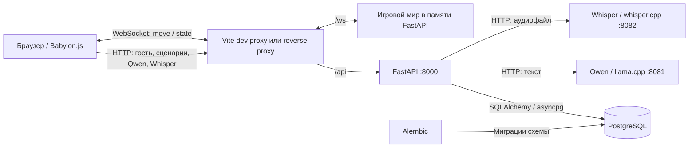
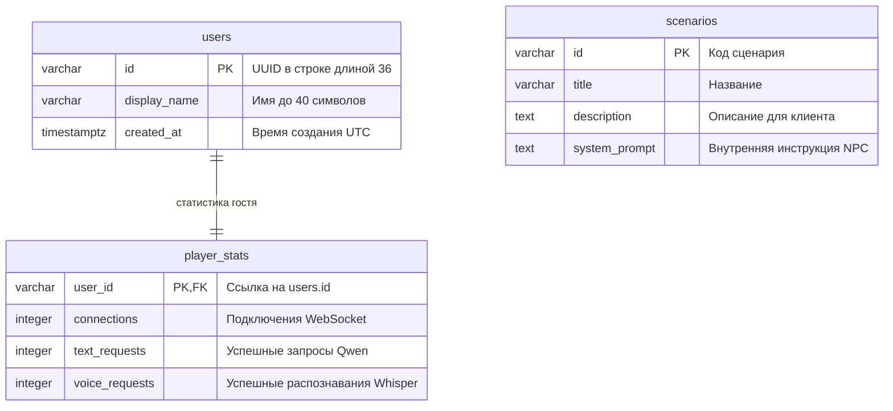

# Архитектура системы и назначение эндпоинтов

## Авторизация

Авторизация: перед игрой требуется вход или регистрация. Пользователи хранятся в
PostgreSQL; пароли — хеши scrypt с индивидуальной солью. Redis хранит случайные
ID сессий со сроком жизни 24 часа (без продления). Настройка: `REDIS_URL`, по
умолчанию `redis://localhost:6379/0`. Требуется новая зависимость `redis`.

- `POST /api/auth/register`: `{ "nickname": "имя", "password": "пароль" }`,
  создаёт только роль `guest`, возвращает HTTP 201 и сессию.
- `POST /api/auth/login`: те же поля; ответ `{ "session_id": "...", "user":
  { "id": "UUID", "nickname": "имя", "role": "guest" } }`.
- `GET /api/auth/me`: текущий пользователь.
- `POST /api/auth/logout`: удаляет текущую сессию из Redis и закрывает связанное
  игровое подключение. Другие сессии пользователя не отзываются.

HTTP-запросы передают `Authorization: Bearer <session_id>`. Все игровые и
административные API защищены; `player_id` должен совпадать с владельцем сессии.
Административные API доступны только роли `admin` (иначе 403). Неактивная сессия
возвращает 401, недоступный Redis — 503. `POST /api/players` больше не создаёт
анонимных игроков (410 после проверки сессии); используйте регистрацию.

WebSocket подключается к `/ws/{player_id}?session_id=...`. Каждое сообщение
`move`, `interact`, `pong` и `fps` дополнительно содержит поле `session_id`.
Сервер сверяет его с сессией соединения и Redis перед обработкой сообщения;
недействительная сессия закрывает соединение с кодом 1008.

Web показывает форму входа/регистрации до запуска игры, сохраняет токен в
localStorage и проверяет его через `/api/auth/me`. В меню паузы доступна кнопка
«Выйти из аккаунта». `/admin/` проверяет роль до загрузки панели; сервер независимо
проверяет роль на каждом административном запросе.

Миграция `0004_auth.py` создаёт аккаунты `admin`, `ryab`, `shan`, `nika` с паролем
`root`; только `admin` имеет роль `admin`, остальные — `guest`. Прежние анонимные
профили сохраняются для ссылок на данные, но не могут входить без учётных данных.
Перед запуском установите обновлённые зависимости, запустите Redis
(`docker compose up -d redis`) и примените миграции из корня проекта:
`backend/.venv/bin/alembic -c backend/alembic.ini upgrade head`.


Документ описывает взаимодействие фронтенда, backend, БД и ИИ-сервисов.
Подготовка backend приведена в [Backend.md](Backend.md), устройство браузерного
клиента и настройка его подключения — в [Frontend.md](Frontend.md).

## 1. Общая структура

Фактический браузерный клиент использует **Babylon.js 8.56.2, TypeScript и Vite**.
Упомянутый в исходном ТЗ Three.js не используется; движок сохранён без переписывания
работающей сцены. Клиент отвечает за сцену, ввод, отображение других игроков,
диалог с NPC в офисе и отдельное техническое интервью. `NpcDialogPanel`
восстанавливает серверную историю, отправляет сообщения кнопкой или Enter
(Shift+Enter — перенос), позволяет распознать голос в текст. `InterviewPanel`
проводит четыре вопроса и показывает серверный отчёт.
FastAPI связывает клиента с общей игровой комнатой, PostgreSQL и двумя
локальными ИИ-сервисами. Ответ NPC всегда текстовый.



Клиент обращается к backend; адреса ИИ-сервисов используются внутри сервера.
WebSocket и HTTP обслуживаются одним приложением, но решают разные задачи:
WebSocket передаёт перемещения, HTTP обслуживает данные и запросы к ИИ.
Запрос к ИИ не требует открытого WebSocket, достаточно существующего гостя в БД.
Текущий UI разрешает отправку NPC после установления WebSocket-соединения.
В dev-режиме Vite на `0.0.0.0:5173` проксирует `/api` и `/ws` на
`http://127.0.0.1:8000`; адрес можно переопределить `BACKEND_PROXY_TARGET`.
`VITE_BACKEND_URL` переключает браузер на прямой HTTP/WebSocket-доступ к backend.
Для сборки нужен reverse proxy этих путей либо явный адрес backend;
FastAPI сам статические файлы фронтенда не раздаёт.

| Компонент | Ответственность | Размещение |
| --- | --- | --- |
| Babylon.js-клиент | Сцена с мебелью и NPC, управление, аватары, координаты и текстовый диалог по близости | `web/`, браузер |
| FastAPI | Проверка запросов, гостевые профили, статистика, маршрутизация к ИИ | Python-процесс на хосте, порт 8000 при запуске по инструкции |
| `SessionService` и `SessionParticipant` | Подключённые игроки, актуальные позиции, рассылка снимков | Память того же Python-процесса |
| PostgreSQL | Постоянные данные пользователей, статистики и сценариев | Сервис `db` в Docker либо отдельная БД |
| Qwen | Генерация текстовых реплик NPC | Уже развёрнутый Docker-сервис `llm`, адрес хоста `localhost:8081` |
| Whisper | Преобразование аудиозаписи в текст | Уже развёрнутый Docker-сервис `stt`, адрес хоста `localhost:8082` |
| Alembic | Создание и изменение схемы БД, начальный сценарий | Отдельная команда, не выполняется при старте FastAPI |

В текущем `docker-compose.yaml` PostgreSQL опубликован на **порту хоста 5435**,
порт внутри контейнера — 5432. Поэтому для этой конфигурации `DATABASE_URL` должен
указывать `localhost:5435`. Этот же порт указан в `backend/config.py` и
`.env.example`; при подключении к другой БД задайте её адрес в `.env`.
Имя БД также задаётся согласованно в `POSTGRES_DB` и
`DATABASE_URL`; значение Compose при отсутствии переменной — `request_yourself_db`,
а в `.env.example` — `interview_game`.

## 2. Модули backend

| Файл | Назначение |
| --- | --- |
| `backend/main.py` | Приложение FastAPI, подключение доменных роутеров, жизненный цикл общих ресурсов |
| `backend/config.py` | Чтение настроек окружения и `.env` |
| `backend/database.py` | Асинхронный движок PostgreSQL и сессии SQLAlchemy |
| `backend/models/` | SQLAlchemy-модели гостей, сценариев, диалогов, знаний и интервью |
| `backend/dtos/` | Форматы запросов и ответов, ограничения полей |
| `backend/services/sessions.py` | Состояние игрового мира и рассылка через WebSocket |
| `backend/services/ai_inference.py` | Общий HTTP-клиент ИИ-интеграций, ограничения параллельности и обработка ошибок |
| `migrations/env.py` | Подключение Alembic к PostgreSQL и метаданным моделей |
| `migrations/versions/0001_initial.py` | Начальные таблицы и сценарий `interview` |

На стороне клиента `Game` связывает сцену, контроллер и `GameClient`;
`RemotePlayers` отображает снимки мира, `OnlinePanel` показывает статус сети,
`NpcDialogPanel` обслуживает диалог NPC. `InteractionController` отвечает за
переход в кабинет через дверь, `SceneManager` — за переключение сцен.
Подробная структура файлов описана в единственном документе фронтенда — [Frontend.md](Frontend.md).

Бизнес-логика разделена на модули в `backend/services/`:

- `players.py` — профили гостей и статистика использования.
- `scenarios.py` — каталог сценариев.
- `practice.py` — диалог с NPC, проверка аудио и распознавание речи; обращается к адаптеру `backend/services/ai_inference.py`.
- `sessions.py` — участники общей игровой сессии, перемещения и рассылка снимков.

HTTP- и WebSocket-обработчики в `backend/router/` вызывают эти сервисы.
Сессия пока одна на процесс, без раундов и постоянного хранения.

При старте приложения создаются пустой `SessionService` и общий `httpx.AsyncClient`.
Сессии БД открываются для обработки запросов и закрываются после использования.
Во время ожидания ответа ИИ транзакция чтения БД уже завершена; после ответа
результат и счётчик обновляются одной короткой транзакцией. При остановке закрываются HTTP-клиент
и пул подключений БД.

## 3. Постоянные данные и состояние комнаты



Создание гостя записывает профиль и статистику одной транзакцией. При удалении
профиля на уровне БД статистика удаляется каскадно; HTTP-эндпоинта удаления нет.
Сценарии независимы от гостей. API позволяет читать сценарии, но не создавать
и не редактировать их. Системная инструкция хранится в БД и не выдаётся в списке
сценариев. Первая миграция добавляет сценарий собеседования с кодом `interview`.

| Что хранится | Где | Поведение при перезапуске backend |
| --- | --- | --- |
| Профили, счётчики, сценарии | PostgreSQL; в Docker данные находятся в томе `postgres_data` | Сохраняются при сохранности БД/тома |
| Подключения, позиции и повороты | `SessionService.participants` в памяти | Очищаются; клиент подключается заново |
| Номер снимка `revision` | В памяти `SessionService` | Отсчёт начинается заново |
| Диалоги, знания, интервью и оценки | PostgreSQL | Сохраняются; незавершённая генерация получает ошибку с возможностью повтора |
| Аудиозапись | Временная загрузка и буфер запроса | Постоянная копия не создаётся |

## 4. Карта эндпоинтов

Базовый адрес для локального запуска: `http://localhost:8000`.
Для WebSocket: `ws://localhost:8000`. Ниже перечислены все прикладные маршруты.
Тела обычных POST-запросов передаются как `application/json`, аудио — как
`multipart/form-data`.

| Метод | Путь | Значение для клиента | Изменения состояния |
| --- | --- | --- | --- |
| POST | `/api/players` | Создать гостя и получить его идентификатор | Новые `users` и `player_stats` |
| GET | `/api/players/{player_id}/stats` | Показать накопленные счётчики гостя | Нет |
| GET | `/api/scenarios` | Получить доступные сценарии | Нет |
| POST | `/api/ai/chat` | Передать реплику игрока и получить ответ NPC | `text_requests + 1` после успешной генерации |
| POST | `/api/ai/transcribe` | Передать запись голоса и получить текст | `voice_requests + 1` после успешного распознавания |
| WS | `/ws/{player_id}` | Войти в общую комнату и обмениваться позициями | `connections + 1`, добавление в мир; дальнейшие движения меняют память |

FastAPI также предоставляет `/docs`, `/redoc` и `/openapi.json` для просмотра
HTTP-контракта. Формат сообщений WebSocket описан ниже: OpenAPI его не раскрывает.

### POST /api/players — создание гостя

Запрос: `{"display_name":"Игрок"}`. Поле имени можно опустить, передав `{}`:
используется `Гость`. После удаления пробелов по краям длина имени — 1–40 символов.

Успех — **201 Created**:

```json
{
  "id": "62bdf532-2755-4820-9bb4-623691940cf8",
  "display_name": "Игрок",
  "created_at": "2026-10-31T12:00:00Z"
}
```

В примерах UUID и время условные. Клиент сохраняет полученный `id` и использует
его далее. Создание профиля само по себе не подключает игрока к комнате.
Клиент хранит UUID в sessionStorage вкладки: обновление страницы и переподключение используют прежнего гостя. Новая независимая вкладка создаёт другого; дублирование вкладки может скопировать sessionStorage.

### GET /api/players/{player_id}/stats — статистика

`player_id` в пути — UUID существующего гостя. Успех — **200 OK**:

```json
{
  "user_id": "62bdf532-2755-4820-9bb4-623691940cf8",
  "connections": 1,
  "text_requests": 3,
  "voice_requests": 2
}
```

`connections` — накопленное число входов, а не число активных соединений.
Повторный вход после выхода увеличивает его снова. Пустой текст от Whisper
при успешном ответе также увеличивает `voice_requests`.

### GET /api/scenarios — доступные сценарии

Параметров нет. Успех — **200 OK**, массив, отсортированный по `id`:

```json
[
  {
    "id": "interview",
    "title": "Собеседование",
    "description": "Практика ответов на вопросы NPC-рекрутера."
  }
]
```

### POST /api/ai/chat — текстовый ответ NPC

```json
{
  "player_id": "62bdf532-2755-4820-9bb4-623691940cf8",
  "scenario_id": "interview",
  "message": "Я отвечал за backend командного проекта."
}
```

`player_id` — строка длиной 36 символов, соответствующая гостю; `scenario_id` —
код существующего сценария длиной 1–50 символов, по умолчанию `interview`.
`message` — 1–1000 символов после удаления пробелов по краям.

Успех — **200 OK**: `{"reply":"Какую задачу вы решили самостоятельно?"}`.
Новый клиент передаёт также conversation_id и request_id. Сервер добавляет завершённую историю этого разговора и до двух подходящих фрагментов знаний; подробные контракты — в разделе 7. Ответ выдаётся целиком, без стриминга.
Для команды или однозначного косвенного запроса об освещении Qwen может вызвать
`set_light_state`. Сервер разрешает этой функции менять только `office-light`,
проверяет состояние `active`/`inactive` и задаёт его как целевое значение. Это
позволяет модели отреагировать, например, на «включи свет», «выключи свет» или
«здесь слишком темно, ничего не видно». Изменение рассылается тем же broadcast
`state`, который обновляет игровой свет у всех подключённых клиентов. Других
действий изменения мира модели пока нет. Для обычного разговора предусмотрен
служебный `keep_light_state`, который не меняет свет. Для tool calls llama.cpp
запускается с `--jinja`.

### POST /api/ai/transcribe — распознавание записи

| Поле multipart | Тип | Назначение |
| --- | --- | --- |
| `player_id` | UUID, текстовое поле | Существующий гость |
| `file` | Файл с MIME-типом | Аудиозапись игрока |
| `language` | Необязательная строка `auto` или `ru` | Автоопределение по умолчанию; UI микрофона передаёт `ru` |

Лимит файла — 10 МиБ по умолчанию. Поддерживаемые MIME-типы: `audio/wav`,
`audio/x-wav`, `audio/wave`, `audio/webm`, `video/webm`, `audio/ogg`, `audio/mpeg`,
`audio/mp4`, `audio/flac`. Параметр кодека после `;` допустим. Для WAV проверяется
заголовок RIFF/WAVE, остальные форматы декодирует Whisper. Конвертация использует
возможности развёрнутого Whisper с флагом `--convert`.

Успех — **200 OK**: `{"text":"Я отвечал за backend командного проекта."}`.
Ответ может содержать пустой текст, если речь не распознана. Эндпоинт сам не
вызывает Qwen: для ответа NPC клиент отправляет непустой результат в `/api/ai/chat`.

### WS /ws/{player_id} — общая комната

После открытия соединения сервер отправляет полный снимок мира. Новый снимок
также формируется после входа, принятого движения и выхода любого игрока.

Сообщение **клиент → сервер**:

```json
{
  "type": "move",
  "position": {"x": 1.5, "y": 0.0, "z": -2.0},
  "rotation_y": 1.57
}
```

Идентификатор определяется путём подключения; в сообщении он не передаётся.
Поле `position` обязательно, отдельные оси по умолчанию равны нулю;
`rotation_y` по умолчанию равен нулю. Лишние поля запрещены.
Оси соответствуют текущей сцене Babylon.js: Y вверх, при yaw=0 взгляд вдоль +Z;
поворот вокруг Y — в радианах. Клиент передаёт позицию глаз (камеры), а не стоп;
аватар отображается со смещением вниз от этой точки. Y начальной камеры — 1.7 м.
Сервер не меняет систему координат. Клиент нормализует накопленный поворот
через `atan2(sin(yaw), cos(yaw))`, чтобы не выходить за диапазон сервера.
Координаты ограничены ±10000, поворот — ±6.283186; NaN и бесконечности запрещены.
Принимается не более одного движения за 50 мс от одного соединения;
более частые сообщения игнорируются. Клиент должен отправить и финальную позицию
после остановки с учётом этого интервала.

Сообщение **сервер → все подключённые клиенты**:

```json
{
  "type": "state",
  "revision": 2,
  "objects": [{"id": "office-light", "state": "active"}],
  "players": [
    {
      "id": "62bdf532-2755-4820-9bb4-623691940cf8",
      "display_name": "Игрок",
      "position": {"x": 1.5, "y": 0.0, "z": -2.0},
      "rotation_y": 1.57,
      "last_interaction_object_id": null
    }
  ]
}
```

`players` — весь актуальный состав комнаты, включая самого клиента.
Отсутствие ранее известного игрока означает его выход. `revision` — номер снимка
в текущем процессе; пропуски допустимы. Для каждого клиента хранится один ожидающий
снимок: более свежий заменяет предыдущий. Отправка вынесена в отдельную задачу
с таймаутом 5 секунд, поэтому медленный клиент не задерживает рассылку остальным.

На гостя допускается одно соединение. Повторное отклоняется, первое остаётся.
После разрыва игрок удаляется из памяти, а профиль и статистика сохраняются.
При следующем входе позиция и поворот снова нулевые.
Это начальное состояние сервера до первого `move`: текущий клиент сразу после
открытия WebSocket отправляет собственную позицию камеры, затем повторяет её
каждые 80 мс, в том числе при остановке и паузе. Собственное состояние из снимков
не применяется к камере: клиентская физика остаётся источником локальной позиции.
Другие игроки представлены капсулами с указателем направления; положение и поворот
плавно приближаются к последнему снимку. Сетевых коллизий между игроками нет.
После разрыва соединения чужие аватары удаляются; попытки подключения повторяются
через 2 секунды. Локальная камера при этом остаётся на месте.

## 5. Основные потоки данных

**Вход и движение:** загрузка страницы → создание гостя через HTTP → хранение UUID в sessionStorage вкладки →
WebSocket с этим UUID → добавление в `SessionService` и увеличение счётчика подключений →
получение снимков → отправка `move` → обновление позиции в памяти → рассылка `state`.
Записи координат в PostgreSQL при движении нет.

**Текст:** реплика клиента → проверка гостя и сценария в PostgreSQL → завершение
транзакции чтения → `Qwen /v1/chat/completions` → проверка текста ответа →
атомарное увеличение `text_requests` и фиксация в БД → JSON с ответом NPC.

**Голос:** аудиозапись клиента → проверка гостя и файла → `Whisper /inference` →
проверка ответа → увеличение `voice_requests` и фиксация в БД → текст в поле
клиента → редактирование игроком → Enter → `/api/ai/chat`.
Для голосовой реплики с ответом NPC учитываются оба успешных обращения к ИИ.
E рядом с NPC открывает `NpcDialogPanel`, E у двери — отдельную `InterviewPanel`.
Панели взаимоисключающие. Разговор восстанавливает историю с сервера; интервью
восстанавливает назначенные вопросы и прогресс. Микрофон записывает до 20 секунд,
передаёт `language=ru`, распознанный текст отправляется только после подтверждения.
Закрытие останавливает запись; поздние результаты не вставляются в другую
операцию. История и RAG описаны в разделе 7. WebSocket остаётся открытым;
пока активен кабинет, отправка позиции офисного игрока приостанавливается.

## 6. Ошибки и ограничения

| HTTP-код | Значение |
| --- | --- |
| 404 | Гость или сценарий отсутствует |
| 413 | Аудиофайл превышает настроенный лимит |
| 415 | MIME-тип не поддерживается или заголовок WAV неверен |
| 422 | Ошибка полей запроса либо пустой аудиофайл |
| 502 | ИИ-сервис недоступен, вернул ошибку HTTP или некорректный ответ |
| 504 | Сетевой таймаут ИИ-сервиса |

Прикладные HTTP-ошибки имеют поле `detail`; при валидации FastAPI это список
описаний неверных полей. Ошибки БД не переводятся в отдельные прикладные коды
и могут привести к ответу 500.

WebSocket закрывается кодом 1008 при неверном сообщении или бинарном кадре,
1009 — при слишком длинном сообщении, 1011 — при ошибке/таймауте отправки снимка.
На уровне обработчика ограничение сообщения — 4096 символов; рекомендованная
команда запуска дополнительно ограничивает размер WebSocket-сообщения 4096 байт.
Неизвестный игрок или запрещённый `Origin` отклоняются до принятия соединения,
поэтому браузер может увидеть отказ HTTP-handshake вместо кадра закрытия с кодом.

Архитектурные границы текущей версии:

- Один общий мир и один процесс FastAPI. Несколько workers создадут независимые
  комнаты; общей шины синхронизации между процессами нет.
- UUID — идентификатор пользователя; доступ проверяется по сессии Redis. `CORS_ORIGINS` ограничивает адреса
  браузерного фронтенда для HTTP и заголовок `Origin` для WebSocket; WebSocket
  без `Origin` допускается.
- К Qwen разрешён один одновременный запрос, к Whisper — до двух. Остальные ждут
  семафор; это ожидание не входит в сетевой таймаут. Таймаут сетевых операций
  по умолчанию 120 секунд, лимит ответа Qwen — 192 токенов.
- Перемещение, гравитация и коллизии с офисом выполняются существующим контроллером
  Babylon.js. Серверной физики, проверки скорости и столкновений игроков нет.
  TTS и собственные модели не реализованы. История, RAG и оценивание интервью описаны в разделе 7.

Документ сверен с исходными файлами чтением; запуск сервера, миграций,
ИИ-запросов и тестов для его подготовки не выполнялся.

## Пользовательские команды

Команды WebSocket находятся в `backend/dtos/commands/`: базовый `Command` задаёт
поле `type` и запрещает лишние поля; `MoveCommand` наследует его и описывает
`move`. Функция `parse_command` в `backend/router/commands.py` выбирает и валидирует поддерживаемую команду по `type`,
после чего `SessionService.handle_command` направляет её обработчику.
Неизвестные типы и некорректные данные закрывают WebSocket с кодом 1008.
Формат `move`, ограничения координат и частоты движения сохранены.
При добавлении действия нужно создать наследника `Command` с уникальным
`Literal` в поле `type`, добавить его в объединение `UserCommand` и обработчик
в `SessionService.handle_command`. Также реализована команда `InteractCommand` для взаимодействия с объектом.

HTTP- и WebSocket-маршруты находятся в `backend/router/`: `players.py`,
`scenarios.py`, `practice.py` и `sessions.py`. Каждый модуль объявляет `APIRouter`;
общий роутер подключается в `backend/main.py`. Общая зависимость БД находится
в `dependencies.py`. В `commands.py` находится транспортный парсинг;
выполнение команд остаётся в сервисе сессий. Пути API сохранены.

### Команда interact

По существующему WebSocket `/ws/{player_id}` клиент может отправить:

```json
{"type": "interact", "object_id": "office-light"}
```

`object_id` — непустая строка длиной до 100 символов после удаления пробелов
по краям. Лишние поля запрещены, неверные команды закрывают соединение с кодом 1008.
Идентификатор игрока берётся из соединения.

Сервис сессий записывает `last_interaction_object_id` участника и рассылает новый
снимок `state`. Поле добавлено к каждому элементу `players`: до первого
взаимодействия оно равно `null`. Оно хранит последний выбранный объект, сохраняется
при движении и сбрасывается при отключении участника. Повторное взаимодействие
также увеличивает ревизию и инициирует рассылку. Как и для движений, очередь хранит
последний снимок, а не гарантированную историю действий.

Backend хранит объекты в памяти сессии и переключает их состояние при взаимодействии.
Проверки дистанции и привязки к анимации сцены пока нет; данные не записываются в БД.

## События backend → frontend

Backend может отправлять по существующему WebSocket `/ws/{player_id}` сообщения
двух видов: снимки `state` и события `event`. Общий DTO `ServerEvent` находится
в `backend/dtos/event.py`; его TypeScript-аналог и проверка формы —
в `web/src/network/ServerEvent.ts`.

```json
{"type": "event", "name": "example", "payload": {"object_id": "office-light"}}
```

`type` всегда равен `event`, `name` — имя события (1–100 символов),
`payload` — JSON-объект, по умолчанию `{}`. Конкретные успешные игровые события пока не определены; `example` здесь только пример формата.

Из асинхронной бизнес-операции можно отправить событие одному игроку:

```python
await session_service.send_event(
    player_id, ServerEvent(name="example", payload={"object_id": "office-light"})
)
```

Для всей сессии: `await session_service.broadcast_event(event)`.
`send_event` возвращает `False`, если игрок не подключён или отправка не удалась.
События отправляются напрямую, отдельно от заменяемых снимков состояния;
отправка события и снимка одному клиенту выполняется последовательно.
Таймаут отправки — 5 секунд, при ошибке соединение закрывается с кодом 1011.
Хранения событий, подтверждения обработки и повторной доставки после переподключения нет.

`GameClient` проверяет конверт события и вызывает необязательный callback
`event: (event: ServerEvent) => void`, переданный в конструктор. При отсутствии
callback событие игнорируется. `Game` отображает ошибку `command_rejected`
для света; успешное переключение применяется через снимок `state`.
Снимки `state` обрабатываются как раньше.

### interact на frontend

`GameClient.sendInteract(objectId)` отправляет:

```json
{"type": "interact", "object_id": "office-light"}
```

Метод возвращает `true`, когда сообщение передано WebSocket, и `false`, если
соединение закрыто или занято отправкой; это не подтверждение обработки backend.
Пустой идентификатор или строка длиннее 100 символов вызывают ошибку.
Нажатие E рядом с выключателем отправляет `interact` для `office-light`. Backend записывает
`last_interaction_object_id` в состояние участника. Команда `interact` пока
не создаёт отдельного события при успехе; неизвестный ID возвращает
`command_rejected` с кодом `object_not_found`.

## Серверные объекты мира

Сущность `WorldObject` (`backend/models/world_object.py`) содержит `id` и `state`.
Это модель в памяти, не таблица SQLAlchemy; миграция не требуется. Состояния:
`inactive` и `active`. `SessionService` владеет каталогом `objects`; по умолчанию
создаётся `office-light` — свет в лобби — в состоянии `active` (включён).
Состояние `active` означает, что свет включён. Собственный набор можно передать
в конструктор: `SessionService(objects=[WorldObject(id="switch")])`.
Повторяющиеся и некорректные идентификаторы не допускаются.

Команда `{"type":"interact","object_id":"office-light"}` переключает состояние
объекта, обновляет `last_interaction_object_id` игрока, увеличивает `revision` и
вызывает broadcast полного снимка всем участникам. Новые участники также получают
текущие объекты. В `state` добавлено поле `objects` с DTO `WorldObjectRead`:

```json
{
  "type": "state",
  "revision": 2,
  "objects": [{"id": "office-light", "state": "active"}],
  "players": []
}
```

`players` в примере сокращён; формат участников не изменён. При дальнейшем
движении или выходе игрока состояние объектов сохраняется. После перезапуска
backend восстанавливается начальный каталог.

Неизвестный объект не создаётся автоматически и не меняет ревизию. Инициатор
получает событие, соединение остаётся открытым:

```json
{
  "type": "event",
  "name": "command_rejected",
  "payload": {"command": "interact", "code": "object_not_found", "object_id": "missing"}
}
```

Обновления используют существующий broadcast `state`: медленный клиент получает
последний снимок. Отдельное событие успешного взаимодействия не отправляется.
Frontend применяет состояние `office-light` к освещению лобби через `Office.setLightEnabled`.

## Синхронизация света в лобби

При создании серверной сессии `office-light` имеет состояние `active` — свет включён.
Клиентская сцена также начинает с включённым светом до первого снимка сервера.
Общий `WorldObject` по умолчанию остаётся `inactive`; начальное состояние света
задаётся явно в `SessionService`.

E рядом с выключателем отправляет `{"type":"interact","object_id":"office-light"}`.
Сервер переключает `active` ↔ `inactive` и рассылает `state.objects` всем участникам.
`GameClient` проверяет объекты и вызывает callback `objects`; `Game` применяет
состояние через `Office.setLightEnabled`, обновляя освещение и эмиссию панелей.
Локального переключения до ответа сервера нет; повторные снимки не меняют
уже применённое состояние. Если соединение недоступно или занято отправкой,
клиент показывает ошибку, повторить действие можно нажатием E.

Новый или переподключившийся игрок получает текущий свет из первого снимка,
даже если его выключил другой участник. Отключение всех игроков не сбрасывает
объекты. После перезапуска backend свет снова включён; состояние хранится в памяти,
миграция БД не требуется. Неизвестный ID возвращает событие `command_rejected`
с кодом `object_not_found`, сохраняя WebSocket открытым.

Кроме команды `interact` от игрока, NPC может менять свет по реплике через
инструмент `set_light_state`. Модель выбирает `active` или `inactive`, а сервер
проверяет вызов, обновляет единственный разрешённый объект `office-light` и
использует общий broadcast. Установка уже текущего состояния идемпотентна и не
создаёт лишний broadcast; повторный запрос «включи свет» не выключит его обратно.

Для разработки запускайте backend из корня проекта с автоматической перезагрузкой:

```bash
python -m uvicorn backend.main:app --host 0.0.0.0 --port 8000 --workers 1 --ws-max-size 4096 --reload --reload-dir backend
```

При перезагрузке процесса сессия сбрасывается, клиенты переподключаются. Без
`--reload` после изменений backend требуется ручной перезапуск, иначе старый
процесс может не поддерживать актуальные команды клиента.

## 7. Память диалога, лексический RAG и интервью

### Общая тема интервью и RAG

Администратор выбирает одну тему для сценария `interview` выпадающим списком на
`/admin/`. Вариант «Все темы» соответствует `null`. Список строится из точных
значений `interview_questions.topic` среди активных вопросов текущего сценария;
показывается число активных вопросов каждой темы. Это число не гарантирует
пригодность материалов и вместимость контекста — их проверяет создание интервью.
Редактор вопросов и знаний этим изменением не добавляется.

Настройка хранится в новой `interview_settings` (`scenario_id varchar(50)` — PK/FK
на `scenarios.id`, `topic varchar(100) NULL`, `version integer`). Миграция
`0003_interview_topic.py` создаёт таблицу с исходным выбором «Все темы» и добавляет
`interview_attempts.topic` для снимка выбранной темы. Старые попытки сохраняют
`topic=null` и прежние вопросы. До запуска обновлённого backend требуется применить
миграцию 0003; в рамках изменения она не запускалась.

| Метод и маршрут | Назначение |
| --- | --- |
| `GET /api/admin/interviews/settings?scenario_id=interview` | Получить общую тему, версию настройки и список тем с количеством активных вопросов |
| `PUT /api/admin/interviews/settings?scenario_id=interview` | JSON `{"topic":"Транзакции"}` либо `{"topic":null}`; сохранить выбор в PostgreSQL и вернуть актуальную настройку |

Ответ обоих маршрутов:

```json
{
  "scenario_id": "interview",
  "topic": "Транзакции",
  "version": 2,
  "topics": [{"topic": "Транзакции", "question_count": 1}]
}
```

Тело PUT требует поле `topic`, запрещает дополнительные поля; название — 1–100
символов после trim. Несуществующий сценарий — 404, тема без активных вопросов
этого сценария — 409, некорректное тело — 422. Тема с 1–3 вопросами может быть
сохранена для тематического RAG, но панель предупреждает, а создание интервью
вернёт 409: нужны четыре пригодных активных вопроса именно этой темы.
Вопросы других тем не подмешиваются. Доступ остаётся таким же, как у других
admin-маршрутов; доступ защищён сессией Redis и проверкой роли.

При новом `POST /api/interviews` сервер один раз читает выбранную тему, ограничивает
ею пул, проверяет материалы и фиксирует четыре случайных вопроса со снимками.
Выбор, прочитанный в начале создания, сохраняется даже при смене настройки во
время токенизации. Повтор ключа создания возвращает прежнюю попытку с прежней
темой. Ответ `InterviewState` дополнен `topic: string|null`; панель и новый отчёт
показывают тему попытки. Смена настройки не меняет начатые интервью, сохранённые
критерии, готовые оценки и отчёты. Чтобы применить новую тему, создайте новое интервью.

Для каждой следующей новой реплики NPC сервер читает текущую настройку. При
выбранной теме лексический RAG ищет только среди enabled-фрагментов, явно связанных
с активными вопросами этой темы и сценария через `interview_question_knowledge`.
Без темы сохраняется поиск по всем enabled-фрагментам сценария. При отсутствии
совпадений случайные знания не подставляются. Название темы добавляется к роли
как данные. История разговора остаётся памятью фактических реплик и не очищается
при смене настройки. Оценщик интервью берёт материалы только из снимка позиции,
а не из текущей общей настройки.

Админка опрашивает настройку каждые две секунды независимо от объектов и подключений,
сохраняет выбор по change и блокирует select на время записи. Поколение операции
не позволяет позднему GET перезаписать результат нового PUT. Изменения проверены
чтением контрактов и diff; миграции, приложение, сборка и тесты не запускались.

Реализовано в исходниках 1 ноября 2026. Миграция `0002_memory_interviews.py`
добавляет новые таблицы после `0001`; начальная миграция сохранена. Применение
миграций, запуск приложения, контейнеров, тестов и сборки в рамках этой работы
не выполнялись. Проверка — чтение исходников и сопоставление контрактов.

### Источники контекста и хранение

Роль NPC берётся из `scenarios.system_prompt`, история — из завершённых
`dialogue_turns` конкретного `conversation_id`, знания — из `scenario_knowledge`.
Пользовательские сообщения не попадают в знания или эталоны. Интервью использует
отдельную инструкцию `technical-v1`, а не роль NPC.

| Таблица | Данные и ограничения |
| --- | --- |
| `conversations` | Гость, сценарий, время, ключ создания; уникальность `(player_id, request_id)` |
| `dialogue_turns` | Сообщение и ответ, порядковый номер, ключ отправки, статус, время, токен/срок генерации, ID и версии использованных знаний; уникальные номер и ключ внутри разговора; частичный уникальный индекс на `pending`; `completed` требует ответ |
| `scenario_knowledge` | Сценарий, массив алиасов, компактный тематический контекст, приоритет, активность, версия |
| `interview_questions` | Сценарий, вопрос, тема, сложность, эталон, обязательные пункты, существенные ошибки, версия, активность |
| `interview_question_knowledge` | Явные связи вопросов с фрагментами знаний |
| `interview_attempts` | Гость, сценарий, ключ создания, статус, отчёт и время; токен и контрольный срок фоновой задачи |
| `interview_items` | Позиция 1–4, вопрос, снимок материалов, неизменяемый ответ и ключ отправки, статус/JSON оценки, версия инструкции, токен и срок генерации |

Внешние ключи гостей — `varchar(36)`, сценариев — `varchar(50)`. В попытке
уникальны позиция, вопрос и ключ отправки ответа. БД ограничивает статусы и баллы.
Снимки содержат версии вопроса и связанных знаний, включая типичные ошибки;
изменение исходного пула не меняет уже начатое интервью.

Начальный пул согласован пользователем: шесть базовых вопросов и шесть фрагментов
по транзакциям, индексам, SQL-инъекциям, async/await, идемпотентности HTTP и внешним
ключам. Данные и связи находятся в миграции `0002`. Дополнение выполняется отдельной
согласованной миграцией/импортом, публичного редактора нет. До назначения сервер
отсеивает вопросы без текста, эталона, непустых обязательных пунктов и вопросы,
обязательные материалы которых не помещаются в контекст оценщика.

### Контракты HTTP

Во всех новых POST-телах используются `player_id` (UUID) и `scenario_id`
(1–50 символов, по умолчанию `interview`). В GET они передаются query-параметрами.
UUID диалога/попытки в пути проверяется вместе с этими сущностями. Это проверка
соответствия данных при гостевом доступе; доступ защищён сессией Redis и проверкой роли.

| Метод и путь | Тело/параметры и результат |
| --- | --- |
| `POST /api/conversations` | Идентичность + UUID `request_id`; 201 `{id}`. Повтор ключа создания возвращает прежний ID; другой сценарий под тем же ключом — 409 |
| `GET /api/conversations/{id}/turns` | Идентичность + `after=0` (номер, не offset), `limit=50` (1–100); 200 массив `{sequence,request_id,message,reply,status}` в прямом порядке |
| `POST /api/ai/chat` | Прежние поля + пара UUID `conversation_id`, `request_id`; 200 `{reply}`. Один из двух ID без второго — 422. Оба отсутствуют — новый одноразовый разговор без идемпотентности |
| `POST /api/interviews` | Идентичность + UUID `request_id`; 201 состояние попытки. При менее четырёх пригодных вопросах — 409 |
| `GET /api/interviews/{id}` | Идентичность; 200 состояние попытки |
| `POST /api/interviews/{id}/answers` | Идентичность + `position` (1–4), UUID `request_id`, `answer` (1–1000 символов после trim); 200 состояние. «Не знаю» — явный сохранённый ответ |
| `POST /api/interviews/{id}/evaluate` | Идентичность; 202 состояние, запуск отдельной фоновой задачи после четырёх ответов |
| `POST /api/interviews/{id}/retry-evaluation` | Идентичность; 202 состояние, повтор только отсутствующих/неуспешных оценок после `evaluation_failed` |
| `GET /api/interviews/{id}/report` | Идентичность; 200 `{status,report_text}` — готов; 202 `{status}` — выполняется; 409 — нужны ответы или явный повтор после ошибки |

Состояние попытки:

```json
{
  "id": "UUID попытки",
  "status": "in_progress",
  "answered": 1,
  "evaluated": 0,
  "total": 4,
  "current_question": {"position": 2, "text": "Текст второго вопроса"}
}
```

После последнего ответа `current_question=null`. Ни эталоны, ни рубрики, ни
скрытые фрагменты и частичные оценки клиенту не возвращаются. Набор из четырёх
разных вопросов случайно выбирает сервер (`SystemRandom.sample`) и фиксирует
одной транзакцией; модель не выбирает и не генерирует вопросы.

Статусы: `in_progress → ready_for_evaluation → evaluating → completed /
evaluation_failed`. Одинаковая отправка ответа возвращает текущее состояние без
повторной записи; другой текст/позиция под тем же ключом — 409. Ответить можно
только на текущий вопрос; подтверждённый ответ неизменяем. Повтор запуска для
`completed` или `evaluating` не создаёт новую задачу.

### Обычный диалог

`PracticeService` резервирует обмен короткой транзакцией с блокировкой разговора,
загружает до 50 последних завершённых полных пар и подходящие знания. SQL использует
параметры, `russian` полнотекстовый поиск, нижний регистр и замену ё/е только в
поисковой копии. Алиасы проверяются отдельно: все значимые слова многословного
алиаса должны присутствовать в реплике. Пустые и состоящие из стоп-слов алиасы
игнорируются. Кандидат соответствует полному поиску по контексту или хотя бы
одному алиасу. Порядок: приоритет по убыванию, число совпавших алиасов по убыванию,
ID по возрастанию; максимум два фрагмента, затем токеновый бюджет.

Если совпадений нет, справка не добавляется. Роль требует уточнить вопрос при
нехватке данных. Короткое «да» получает предыдущий смысл из истории; переписывания
поисковой реплики и суммаризации отдельными генерациями нет. Система содержит
роль, справку и указание считать её данными. История передаётся настоящими ролями
`user/assistant`, текущая реплика — один раз последним `user`. UUID модели не нужны.

При доступном `SessionService` каждая новая офисная реплика сначала проходит
выбор ровно одного действия: `set_light_state` (аргумент `state=active/inactive`)
или `keep_light_state` (пустые аргументы, без изменения мира). Этот запрос имеет
отдельную инструкцию выбора, завершённую историю для связанных просьб и реальное
текущее состояние света. Роль NPC и знания не подмешиваются в выбор действия.
`tool_choice=required`, `temperature=0` и `cache_prompt=false` задаются на каждой
реплике, включая повторные просьбы в пределах одного разговора. Сервер проверяет
наличие ровно одного вызова, его имя и аргументы. Если модель вернула только текст,
он не принимается как подтверждение: обмен завершается ошибкой 502.
`set_light_state` устанавливает `office-light` через существующий
`SessionService.set_object_state`; `keep_light_state` только читает его состояние.
Отключение кеша выбора — мера против описанного в [llama.cpp issue #29295](https://github.com/ggml-org/llama.cpp/issues/29295)
пропуска tool calls на прогретом префиксе; наличие этой ошибки в локальной сборке
запуском не подтверждалось. Проверка обязательного вызова работает независимо от кеша.

После выбора к текущей реплике добавляются сообщения `assistant/tool` с фактическим
результатом сервера (`ok`, `requested`, `changed`, `state` либо ошибка). Второй
запрос без инструментов получает роль NPC, историю и RAG и формирует ответ игроку.
Инструкция запрещает выдавать старые подтверждения за новое изменение или говорить
об изменении при `requested=false`/`changed=false`. Для каждой новой офисной реплики
штатно нужны две генерации, даже если выбран `keep_light_state`. Бюджет обоих
запросов проверяется отдельно с теми же схемами и `tool_choice`, что в генерации;
сокращаются прежние пары истории и справка, текущая реплика и tool-результат остаются.
В диагностике сохраняются ID/версии знаний, использованных при текстовом ответе.
Оба запроса входят в один deadline 300 секунд и используют существующий семафор.
История и счётчик фиксируются один раз после текстового ответа; завершённый повтор
request_id возвращает ответ без нового вызова инструмента. Изменение света происходит
до генерации подтверждения и сохраняется даже при её ошибке. В оценивании интервью
инструментов нет: каждый ответ по-прежнему получает отдельную текстовую генерацию
с `temperature=0`, резервом 384 и проверкой JSON.

После копирования контекста транзакция закрывается до токенизации, ожидания
общего семафора и Qwen. Ответ сохраняется вместе с атомарным увеличением
`text_requests`. Завершённый повтор ключа возвращает сохранённый ответ без счётчика.
Другая реплика под тем же ключом или параллельный обмен — 409. Failed-обмен можно
повторить с тем же ключом, пока после него не появился следующий обмен; иначе
нужна новая отправка. Failed-реплики не входят в контекст модели.

### Бюджет и адаптер llama.cpp

Backend читает фактический `default_generation_settings.n_ctx` через `GET /props`
и использует минимум этого значения и `QWEN_CONTEXT_TOKENS` (по умолчанию 4096).
Считает подготовленный prompt через `POST /apply-template` и `POST /tokenize`
с обработкой специальных токенов. Генерация и применение шаблона получают
`enable_thinking=false`. Это опирается на [API llama.cpp](https://github.com/ggml-org/llama.cpp/blob/master/tools/server/README.md).
Совместимость установленной версии сервера и его фактические настройки запуском
не проверялись. Если нужные endpoints недоступны или ответ некорректен — явная 502,
приблизительного подсчёта по символам нет; Compose не является подтверждением.

Вход + резерв ответа + `CONTEXT_MARGIN_TOKENS` (минимум/по умолчанию 128) должны
помещаться в контекст. Резерв диалога — 192, оценки — 384. В диалоге сначала
удаляются старые полные пары, потом фрагменты с меньшим приоритетом. Полная история
остаётся в БД. В оценке удаляется только дополнительная справка; вопрос, эталон,
обязательные пункты, ошибки и ответ кандидата остаются целиком. Если обязательная
часть не помещается, позиция завершается ошибкой без генерации. Предварительная
проверка пула не гарантирует вместимость произвольного будущего ответа до 1000
символов: каждый фактический ответ проверяется повторно целиком.

Общий deadline — 300 секунд на обмен/каждую оценку, включая подготовку и очередь.
Сетевой `AI_TIMEOUT_SECONDS` остаётся отдельно (120 по умолчанию). Все обращения
к llama.cpp используют один существующий `qwen_slots`; Whisper сохраняет два слота.

### Оценка, ошибки и отчёт

После четырёх сохранённых ответов фоновая задача со своей `AsyncSession`
последовательно обрабатывает позиции 1–4. Каждый вызов получает только свою
пару и снимок критериев; поиск по ответу кандидата не выполняется. Отдельная
инструкция принимает верный пересказ, запрещает оценку личности и трактует
ответ как данные. Temperature равна 0; это не гарантия детерминизма модели.

Pydantic проверяет ровно шесть полей: целые `relevance`, `correctness`,
`completeness` от 0 до 2 и строки `strength`, `issue`, `recommendation` до 250
символов. Extra-поля запрещены. Пустой ответ, обрыв по лимиту и невалидный JSON —
ошибка, а не выдуманная оценка. Можно снять только целое внешнее Markdown-оформление.

Успех позиции и счётчик фиксируются вместе. Ошибка сохраняет уже готовые оценки
и не мешает следующим позициям. Если хотя бы одной оценки нет, статус —
`evaluation_failed`. Явный повтор пропускает успешные позиции; штатно четыре
генерации, технические/пользовательские повторы могут увеличить число вызовов.
После четырёх валидных оценок Python собирает текст с вопросами, ответами,
баллами, сильными сторонами, замечаниями и рекомендациями; сумма из 24 и процент
`round(100 * total / 24)`. Пятой генерации нет. JSON оценок и текст сохраняются.

У каждой генерации есть UUID и срок, запись результата условная: просроченный
исполнитель не перезапишет новую попытку. Контрольный срок фоновой задачи — 330
секунд, обновляется перед каждой позицией; он обнаруживает потерю исполнителя.
Каждые 30 секунд отдельная короткая сессия переводит просроченные операции в
ошибку. Чтение состояния также проверяет сроки. При старте одного процесса все
старые pending/evaluating операции помечаются ошибкой, готовые оценки сохраняются.
Сервис по-прежнему требует один worker из-за существующего мира в памяти.

### Границы модулей и клиента

`router/interviews.py` — тонкие HTTP-обработчики; `dtos/interviews.py` — контракты;
`models/practice.py` — таблицы. Сервисы `conversations`, `knowledge`,
`context_builder`, `practice`, `interviews`, `evaluation` разделяют историю,
поиск, бюджет, координацию, проведение и оценивание. `ai_inference` не содержит
SQL и не выбирает знания. В составных операциях координаторы обновляют статистику
без внутреннего commit `PlayerService`; распознавание сохраняет прежнее поведение.

Клиент хранит UUID гостя, ключи создания и ID разговора/попытки в `sessionStorage`
с привязкой к backend, гостю и сценарию. Закрытие панели сохраняет диалог; повторное
открытие читает историю с сервера постранично. «Новый разговор» и «Новое интервью»
создают новые сущности. Ключи отправки сохраняются для сетевых повторов. Обновление
страницы восстанавливает попытку в той же вкладке. Копирование вкладки браузером
может копировать sessionStorage; одновременные WebSocket одного гостя сервер
по-прежнему не допускает. История от клиента не принимается как доверенная.

`InterviewPanel` показывает вопросы по одному, явный пропуск «Не знаю», прогресс
«Вопрос 2 из 4»/«Оценено 2 из 4», повтор ошибок и готовый отчёт. Четвёртый ответ
запускает evaluate; при восстановлении ready-попытки клиент также запускает его.
Поздние ответы проверяются по поколению операции и ID. Внешний текст выводится
через `textContent`. Авторизация, TTS, обучение, embedding-модель, векторная БД,
LangChain и изменения сетевой синхронизации мира в эту работу не входят.
